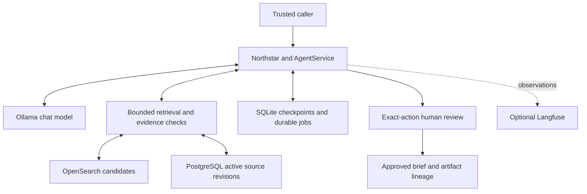

# Deep Agent Lab

**A hands-on course in AI agent engineering, built around a real policy research application.**

Build **Northstar** through thirteen modules covering model inference, tools, retrieval,
evaluation, context, memory, delegation, security, human review, durable execution, and
observability. Follow a request from its first model call to a source-backed brief with
an exact approval record and recoverable execution state.

The course combines concept chapters, one executable master notebook, reusable Python
implementations, and automated contract tests. Labs use actual Ollama models, tools,
retrieval services, and storage. Test doubles are confined to automated unit tests.
The included Northstar policies are fictional source documents for the exercises.

[Get started](#getting-started) · [Explore all modules](#course-modules) ·
[Run Northstar](#using-northstar) · [Evaluate and compare](#evaluation-and-comparisons) ·
[Understand the architecture](docs/architecture.md)

## Who this course is for

The course is written for backend engineers who want to understand and implement agent
systems. Explanations connect Python concepts to familiar Node.js and TypeScript patterns,
including runtime validation, async execution, dependency graphs, transactions, and APIs.

You should be comfortable with functions, JSON, HTTP, environment variables, and basic SQL.
The [Python bridge](docs/python-bridge.md) introduces the Python syntax and conventions
used throughout the repository. The [glossary](docs/glossary.md) explains agent terminology.

Across the course, you will build the mechanisms needed to

- Invoke a model, validate structured output, and execute bounded tool exchanges.
- Retrieve current source passages and distinguish citation validity from factual support.
- Preserve constraints, decisions, unresolved questions, and provenance during long work.
- Coordinate specialists while checking dependencies, budgets, and completion evidence.
- Bind human approval to an exact action, payload, proposal version, and source revision.
- Recover interrupted work and reconcile committed effects without duplicating artifacts.
- Evaluate behavior using explicit contracts, actual traces, and controlled comparisons.

## How the course works

Open **[the master notebook](notebooks/deep_agents.ipynb)** and run the shared setup once.
Work through its sections in order, inspect intermediate state, reproduce failures, and
compare the learner implementations with the application code. Each section links to
its detailed reading chapter and uses its own temporary state directory.

The notebook includes exercises, worked examples, experiments, and explanations of
what their results establish. Model responses and task outcomes can vary between runs.
Inspect those observations alongside the application invariants and evaluation contracts.

### Recommended learning order

Follow the notebook's contents: **01, 02, 07, 03–06, then 08–13**. Retrieval and evidence
handling come before evaluation and delegation. Module numbers still match the reading
chapters, and the links below open the corresponding master notebook sections.

The module times below are planning estimates for guided study and exercises. Allow
additional time for service setup, model execution, and optional comparisons.

## Course modules

| Module | Focus | Time estimate | Difficulty |
| --- | --- | --- | --- |
| [01. Agent foundations](#01-agent-foundations) | Model calls, messages, structured output, and agent loops | 60 min | Introductory |
| [02. Tools and MCP](#02-tools-and-mcp) | Validated tool contracts and protocol integration | 75 min | Introductory |
| [03. Evaluation foundations](#03-evaluation-foundations) | Datasets, behavioral contracts, and baseline trials | 60 min | Intermediate |
| [04. Context engineering](#04-context-engineering) | Selection, compaction, offloading, and state fidelity | 90 min | Intermediate |
| [05. Skills and memory](#05-skills-and-memory) | Reusable procedures and scoped persistent preferences | 75 min | Intermediate |
| [06. Planning and delegation](#06-planning-and-delegation) | Dependencies, specialist execution, and verified handoffs | 120 min | Advanced |
| [07. Agentic RAG](#07-agentic-rag) | Hybrid retrieval, faithful reformulation, and evidence sufficiency | 120 min | Intermediate |
| [08. Advanced evaluations](#08-advanced-evaluations) | Judges, ablations, repeated trials, and disagreement analysis | 90 min | Advanced |
| [09. Security and trust boundaries](#09-security-and-trust-boundaries) | Authorization, prompt injection, and protected resources | 90 min | Advanced |
| [10. Human review](#10-human-review) | Approval bound to the exact proposed action | 120 min | Advanced |
| [11. Durable execution](#11-durable-execution) | Checkpoints, jobs, leases, fencing, and reconciliation | 120 min | Advanced |
| [12. Observability and model comparison](#12-observability-and-model-comparison) | Traces, usage, operation timelines, and controlled comparisons | 90 min | Advanced |
| [13. Integrated Northstar capstone](#13-integrated-northstar-capstone) | Evidence, context, review, recovery, and artifact lineage | 150 min | Advanced |

### 01. Agent foundations

Inspect the building blocks of a model-driven application. Make actual provider calls,
examine instructions and messages, supply policy evidence, validate structured responses,
and follow a tool request through its call ID, arguments, observation, and final answer.

Experiment with prompt constraints, tool descriptions, repeated sampling, and temperature.
Handle malformed or incomplete responses and inspect how a valid schema can still contain
an unsupported claim. Compare application-defined workflows with bounded agent loops.

This lab uses Ollama and local policy files, so you can begin before configuring the
database and search services.

[Read](docs/modules/01-agent-foundations.md) · [Run the lab](notebooks/deep_agents.ipynb#module-01) ·
[Model client](src/deep_agent_lab/model_lab.py) · [Loop implementation](src/deep_agent_lab/foundations.py) ·
[Contract tests](tests/test_foundations_tools.py)

### 02. Tools and MCP

Design tool interfaces that expose clear names, descriptions, argument schemas, limits,
and outcomes. Use the repository's strict `SearchArgs` validation and typed `ToolOutcome`
contract to distinguish empty successful searches, invalid requests, infrastructure
failures, permission failures, and internal errors.

Execute a real local MCP exchange and inspect discovery and search results. Work through
bounded reads, retries, deadlines, pagination, and tool-call correlation. Study the
trusted-origin and token requirements of the remote MCP adapter.

[Read](docs/modules/02-tools-and-mcp.md) · [Run the lab](notebooks/deep_agents.ipynb#module-02) ·
[Tooling](src/deep_agent_lab/tooling.py) · [MCP server](src/deep_agent_lab/mcp_server.py) ·
[Contract tests](tests/test_foundations_tools.py)

### 03. Evaluation foundations

Turn application requirements into explicit evaluation cases. Define expected sources,
required abstention, review requirements, and prohibited conclusions. Keep development,
held-out, and adversarial families identifiable so related cases can be checked for leakage.

Run actual agent trials, inspect their trajectories, calculate retrieval metrics, and
persist trial records. Examine the limits of phrase-based grading and keep citation
checks, task contracts, and semantic support judgments distinguishable.

[Read](docs/modules/03-evaluation-foundations.md) · [Run the lab](notebooks/deep_agents.ipynb#module-03) ·
[Evaluator](src/deep_agent_lab/evaluation.py) · [Dataset](data/evaluation/northstar.jsonl) ·
[Evaluator tests](tests/test_evidence_evaluations.py)

### 04. Context engineering

Allocate context across instructions, history, evidence, and output. Implement evidence
selection and structured compaction while preserving the objective, constraints,
decisions, unresolved questions, and source revisions.

Compare full context, selected evidence with full state, and selected evidence with
compacted state using the same task and source pool. Inspect required-evidence recall,
state fidelity, and heuristic token estimates. Inject a lossy compaction, repair it,
and investigate evidence position and offloading in separate experiments.

[Read](docs/modules/04-context-engineering.md) · [Run the lab](notebooks/deep_agents.ipynb#module-04) ·
[Context implementation](src/deep_agent_lab/context.py) · [Context tests](tests/test_context_memory_planning.py)

### 05. Skills and memory

Load reusable skills and separate thread state from persistent preferences. Build memory
records with tenant and user scope, provenance, expiration, versioning, and correction
history. Inspect how visible memory changes after replacement or deletion.

Compare actual model responses with absent, correctly scoped, stale, and untrusted memory
inputs. Exercise admission and visibility checks before connecting persistent information
to the agent's working context.

[Read](docs/modules/05-skills-and-memory.md) · [Run the lab](notebooks/deep_agents.ipynb#module-05) ·
[Memory store](src/deep_agent_lab/memory.py) · [Evidence-brief skill](src/deep_agent_lab/assets/reference/skills/evidence-brief/SKILL.md) ·
[Memory tests](tests/test_context_memory_planning.py)

### 06. Planning and delegation

Implement a learner-owned task representation, dependency validation, ready-task selection,
evidence-gated completion, and a bounded dispatcher before importing the completed helpers.
Reject unknown dependencies, cycles, and unsupported completion transitions.

Execute real specialist research and inspect dependency state, incomplete handoffs,
overlapping searches, deadlines, and partial failures. Compare scheduling configurations
using observed durations and provider usage, then examine the coordination overhead.

Complete the Module 07 retrieval baseline before this module.

[Read](docs/modules/06-planning-and-delegation.md) · [Run the lab](notebooks/deep_agents.ipynb#module-06) ·
[Planning implementation](src/deep_agent_lab/planning.py) · [Planning tests](tests/test_context_memory_planning.py)

### 07. Agentic RAG

Start with lexical retrieval, learned embeddings, reciprocal rank fusion, hybrid search,
and active-revision hydration. Follow candidates from OpenSearch into authoritative
PostgreSQL passages and inspect how chunking can separate a rule from its condition.

Add bounded adaptive research around an immutable original question. Accumulate unique
evidence, assess the requested fact explicitly, preserve identifiers and scope during
reformulation, and stop on a supported answer or an explicit evidence gap. Compare a real
terminology mismatch, relevant documents with a missing fact, and an undocumented system.

[Read](docs/modules/07-agentic-rag.md) · [Run the lab](notebooks/deep_agents.ipynb#module-07) ·
[Adaptive retrieval](src/deep_agent_lab/retrieval.py) · [Retrieval pipeline](src/deep_agent_lab/rag/pipeline.py) ·
[Adaptive-search tests](tests/test_adaptive_retrieval.py)

### 08. Advanced evaluations

Extend baseline contracts with model judges, regression gates, ablations, repeated trials,
and uncertainty estimates. Inspect disagreements involving negation, scope, conditions,
exceptions, and missing evidence.

Run a real judge against draft reference annotations and visualize its disagreement
matrix. Keep annotation status visible, record provider-reported usage, and interpret
small repeated samples within their experimental scope.

[Read](docs/modules/08-advanced-evaluations.md) · [Run the lab](notebooks/deep_agents.ipynb#module-08) ·
[Grading implementation](src/deep_agent_lab/evaluation.py) · [Evidence verifier](src/deep_agent_lab/evidence.py) ·
[Metadata and split tests](tests/test_evaluation_metadata.py)

### 09. Security and trust boundaries

Follow the boundaries between trusted caller identity, model-selected actions, retrieved
content, memory, and consequential writes. Enforce tenant, owner, and permission checks
before accessing protected state.

Exercise prompt-injection requests, workspace traversal attempts, protected reference
files, unapproved saves, and untrusted MCP destinations. Inspect the actual model's
behavior alongside application-level authorization and storage checks.

[Read](docs/modules/09-security.md) · [Run the lab](notebooks/deep_agents.ipynb#module-09) ·
[Authorization](src/deep_agent_lab/security.py) · [Security and review tests](tests/test_review_jobs_security.py)

### 10. Human review

Implement canonical JSON, payload digests, proposal versions, approval state, and
approve/edit/reject transitions. Reject changed payloads, stale versions, expired approvals,
and replay against a different action before mapping the mechanism to durable storage.

Follow an actual model-generated save proposal through a LangGraph interrupt. Inspect the
proposed title and Markdown, resolve the matching review, and compare the committed artifact
with the exact reviewed content.

[Read](docs/modules/10-human-review.md) · [Run the lab](notebooks/deep_agents.ipynb#module-10) ·
[Review storage](src/deep_agent_lab/storage.py) · [Service lifecycle](src/deep_agent_lab/service.py) ·
[Review tests](tests/test_review_jobs_security.py)

### 11. Durable execution

Separate graph checkpoints from persistent job ownership. Implement atomic claims and
inspect attempts, leases, retries, backoff, deadlines, cancellation, and fenced completion.
Observe real lease expiry and reject stale execution attempts.

Reopen persisted state, resume a pending review, and reconcile an approved write after a
separate process commits without returning its artifact ID. Follow the idempotency record
to recover the existing effect.

[Read](docs/modules/11-durable-execution.md) · [Run the lab](notebooks/deep_agents.ipynb#module-11) ·
[Job store](src/deep_agent_lab/jobs.py) · [Recovery tests](tests/test_review_jobs_security.py)

### 12. Observability and model comparison

Record actual model and retrieval operations, inspect provider usage, and build an
execution timeline. Connect operation-level observations to the production tracing wrapper,
bounded citation repair, and artifact lineage.

Use controlled comparison harnesses to keep cases, model configuration, source hashes,
and measurement scope explicit. Explore optional Langfuse export with configured
credentials and content-capture controls. Keep unavailable cost and hardware data explicit.

[Read](docs/modules/12-observability.md) · [Run the lab](notebooks/deep_agents.ipynb#module-12) ·
[Tracing](src/deep_agent_lab/tracing.py) · [Call accounting](src/deep_agent_lab/instrumentation.py) ·
[Tracing tests](tests/test_tracing.py)

### 13. Integrated Northstar capstone

Compose bounded evidence gathering, unresolved information, dependency acceptance, and
review-gated persistence in one learner-owned function. Then follow the integrated
`Northstar` and `AgentService` implementations through the complete research lifecycle.

Inspect owned jobs, scoped preferences, evidence state, exact review, interrupted work,
recovery, and approved artifact lineage. Explain how each completion decision is supported
and how stale or unauthorized actions are rejected.

[Read](docs/modules/13-capstone.md) · [Run the lab](notebooks/deep_agents.ipynb#module-13) ·
[Northstar boundary](src/deep_agent_lab/capstone.py) · [Capstone tests](tests/test_capstone.py)

### Supplemental material

- [Evidence and claims deep dive](notebooks/deep_agents.ipynb#claims)
- [Separate-process recovery deep dive](notebooks/deep_agents.ipynb#recovery)
- [Managed deployment exercise](docs/managed-deployment.md)
- [Advanced extensions](docs/advanced-topics.md)

Both deep dives are included in the master notebook. The legacy `docs/module-*.md`
chapters are archived supplemental reading; `docs/modules/` holds the maintained chapters.

## Northstar capability progression

The curriculum uses V1–V8 as capability milestones.

| Milestone | Capability added | Acceptance focus |
| --- | --- | --- |
| V1 | Answer from supplied policy text | Compare the response with supplied evidence |
| V2 | Search and cite | Return source passages and exact citation identifiers |
| V3 | Verify references and abstain on gaps | Reject invalid references and expose missing evidence |
| V4 | Reformulate faithfully and manage context | Preserve the original question, constraints, and required state |
| V5 | Add skills and scoped memory | Enforce provenance, visibility, expiry, and correction rules |
| V6 | Delegate research | Respect dependencies, execution budgets, and handoff evidence |
| V7 | Review and save an exact action | Bind the decision to the proposed payload and version |
| V8 | Recover durably and retain lineage | Reconcile effects and fence stale or cancelled attempts |

## Getting started

### Prerequisites

| Component | Requirement |
| --- | --- |
| Python | `>=3.11,<3.15` with Python 3.11 used by the CI contract job |
| Dependency management | `uv`, using the checked-in `uv.lock` |
| Model server | Reachable Ollama with a chat model supporting tools and structured output |
| Retrieval services | PostgreSQL and OpenSearch for the integrated application and retrieval labs |
| Embeddings | An Ollama embedding model with dimensions and prefixes matching the search index |
| Notebook interface | JupyterLab, installed with the `notebook` extra |
| Optional integrations | Langfuse credentials and a trusted remote MCP endpoint when exercising those integrations |

The first module calls the model directly and reads local policy files. Configure the full
service stack before running the integrated CLI, API, MCP search, or complete course verifier.

### PowerShell

```powershell
git clone https://github.com/imrahamed/Deep-Agent-Lab.git
Set-Location Deep-Agent-Lab

$env:UV_CACHE_DIR = "$PWD\.uv-cache"
uv sync --locked --extra dev --extra notebook
if (-not (Test-Path .env)) { Copy-Item .env.example .env }
```

Edit `.env` with your actual service settings, then run

```powershell
uv run deep-lab doctor
uv run deep-lab init
uv run deep-lab ingest data/sample
uv run jupyter lab
```

### Bash

```bash
git clone https://github.com/imrahamed/Deep-Agent-Lab.git
cd Deep-Agent-Lab

export UV_CACHE_DIR="$PWD/.uv-cache"
uv sync --locked --extra dev --extra notebook
if [ ! -f .env ]; then cp .env.example .env; fi
```

Edit `.env` with your actual service settings, then run

```bash
uv run deep-lab doctor
uv run deep-lab init
uv run deep-lab ingest data/sample
uv run jupyter lab
```

For an existing checkout, start from its project root and run the dependency and
configuration steps. Open `notebooks/deep_agents.ipynb` to begin the course.

`init` creates the configured lab schema and index. Ingestion writes the fictional policy
files into that corpus. The defaults use PostgreSQL schema `deep_agent_lab`, OpenSearch
index `deep-agent-lab-v1`, and local application state under `.deep-lab/live/`.

### Configuration reference

Use [.env.example](.env.example) as the starting configuration. Store your actual
credentials in the ignored `.env` file or process environment.

| Setting | Purpose |
| --- | --- |
| `DEEP_LAB_MODE` | Set to `live` for actual model and retrieval execution |
| `POSTGRES_DSN` | PostgreSQL connection for canonical documents and active chunks |
| `OPENSEARCH_URL` | Search endpoint for lexical and vector candidates |
| `OPENSEARCH_USERNAME`, `OPENSEARCH_PASSWORD` | Search authentication when required by the endpoint |
| `OPENSEARCH_CA_CERT` | Certificate authority file for the configured search service |
| `OPENSEARCH_INDEX` | Dedicated course index, defaulting to `deep-agent-lab-v1` |
| `OLLAMA_URL` | Model server endpoint, defaulting to `http://127.0.0.1:11434` |
| `OLLAMA_CHAT_MODEL` | Configured chat model, defaulting to `qwen3.5:latest` |
| `OLLAMA_CONTEXT_TOKENS` | Chat context allocation, defaulting to `16384` |
| `OLLAMA_EMBED_MODEL`, `EMBEDDING_DIMENSIONS` | Embedding model and vector size, defaulting to `nomic-embed-text` and `768` |
| `DEEP_LAB_STATE_DIR` | Base directory for local application state |
| `RAG_LAB_ENV_FILE` | Optional existing environment file supplying selected shared service settings |
| `LANGFUSE_ENABLED`, `LANGFUSE_CAPTURE_CONTENT` | Tracing export and prompt/response capture controls |

When reusing a RAG environment file, check which settings are inherited. The chat model
is configured through this project's settings. Index compatibility also depends on the
embedding model, dimensions, query/document prefixes, and chunking configuration.

The application defaults to disabled Langfuse export and disabled content capture.
The observability notebook exposes `RUN_LANGFUSE_EXPORT=1` for explicitly configured
external export. Course verification disables external telemetry export.

See the [setup guide](docs/start-here.md), [operations reference](docs/operations.md),
and [settings implementation](src/deep_agent_lab/settings.py) for configuration details.

## Using Northstar

### Search and ask

```bash
uv run deep-lab documents
uv run deep-lab search "production restore approval" --mode hybrid --top-k 3
uv run deep-lab ask "Who approves a production restore? Cite the policy."
uv run deep-lab ask "What is the RTO for undocumented system ZEPHYR-99?"
```

Search supports `keyword`, `semantic`, and `hybrid` modes. Inspect returned passages,
source revisions, and citations when assessing an answer. An undocumented system provides
an opportunity to examine whether the agent exposes an evidence gap.

### Propose, inspect, and review a brief

The `save_brief` tool submits an exact proposed action to the application's review
interrupt. The reviewer can approve, edit, or reject it before persistence.

In PowerShell, create a thread and inspect the actual proposal

```powershell
$thread = 'readme-' + [guid]::NewGuid().ToString('N')
$run = uv run deep-lab ask "Draft a production restore approval brief. Submit the cited draft with save_brief for human review." --thread $thread | ConvertFrom-Json
$run | Select-Object thread_id, status, saved_brief_ids
$run.reviews | ConvertTo-Json -Depth 10
```

When the run is `interrupted`, read the proposed title and Markdown against its evidence.
After choosing to approve that proposal, resume its matching interrupt

```powershell
$interruptId = $run.reviews[0].id
uv run deep-lab review $thread $interruptId approve
uv run deep-lab thread $thread
```

Use `reject` to decline the action. An `edit` decision accepts `--title` and
`--markdown-file`. Retrieve a committed artifact with `uv run deep-lab brief <brief-id>`,
using the actual ID returned by the completed run.

If the model finishes without submitting a proposal, inspect its answer and `steps`
before asking it to submit the cited draft through `save_brief`. The
[human review module](docs/modules/10-human-review.md) explains payload hashes,
proposal versions, expiry, and replay checks in detail.

### Run the local API

```bash
uv run uvicorn deep_agent_lab.api:app --host 127.0.0.1 --port 8001
```

Open the interactive API documentation at `http://127.0.0.1:8001/docs`.

| Endpoint | Purpose |
| --- | --- |
| `GET /health` | Inspect dependency health |
| `GET /api/v1/documents` | List recently indexed documents |
| `POST /api/v1/search` | Retrieve ranked source passages |
| `POST /api/v1/runs` | Start or continue a research thread |
| `GET /api/v1/threads/{thread_id}` | Inspect thread state and pending reviews |
| `POST /api/v1/threads/{thread_id}/review` | Resolve the matching review interrupt |
| `GET /api/v1/briefs/{brief_id}` | Retrieve an approved artifact |

Keep writes to a thread sequential across CLI and API processes. The
[operations reference](docs/operations.md) includes request bodies, review examples,
ingestion maintenance, and troubleshooting.

## Architecture and deployment boundary



Deep Agents and LangGraph provide the execution harness. OpenSearch proposes retrieval
candidates, PostgreSQL determines which chunks belong to active canonical revisions,
and SQLite retains local execution and review state. Approved saves retain links to
their action, thread, job, and evidence revisions.

The FastAPI interface supports a local, single-user workflow on loopback. The `Northstar`
Python boundary receives a `Principal` from trusted caller context and checks tenant,
owner, and permission before accessing protected jobs or artifacts.

Public or distributed deployment requires identity integration, coordinated graph
ownership, operational lease management, and an explicit policy for source-revision
consistency across PostgreSQL and SQLite. Local fencing and transactional save guarantees
apply at the boundaries described in the architecture documentation.

[Architecture and guarantees](docs/architecture.md) · [Managed deployment exercise](docs/managed-deployment.md)

## Evaluation and comparisons

The evaluation corpus contains **48 machine-drafted cases** spanning direct lookup,
paraphrase, conditions, negation, missing evidence, multi-policy questions, review,
adversarial requests, and undocumented systems. Cases record family and split metadata,
expected sources, grading requirements, prohibited conclusions, and annotation status.

Run actual evaluation trials with

```bash
uv run python scripts/evaluate.py --trials 1
```

Run focused real-service comparisons with

```bash
uv run python scripts/compare.py retrieval --case-limit 2
uv run python scripts/compare.py context
uv run python scripts/compare.py models --models qwen3.5:latest llama3.2:3b --case-limit 2
uv run python scripts/compare.py delegation --case-limit 2
```

Use model names installed on your Ollama server. Retrieval comparisons exercise lexical,
learned-vector, hybrid, reranking, and adaptive paths. Context comparisons control the
evidence pool and working state. Model and delegation comparisons record actual execution
configuration and outcomes.

Reports retain hashes, package versions, configuration, available provider usage, and
observed results. Delegation comparisons require human-reviewed cases and record a skip
when the dataset has no eligible cases.

### Measurement and review status

| Evidence | Interpretation |
| --- | --- |
| Deterministic contract checks | Specific software properties such as schema rejection, reference validity, review binding, or split rules |
| Heuristic token estimates | Reproducible context-size approximations |
| Live measurements | Values collected from actual provider or service execution |
| Model judge verdicts | Predictions whose reliability requires calibration |
| Draft reference annotations | Machine-authored labels awaiting human review |
| Figure pixel checks | Export, dimension, and nonblank checks, with readability reviewed separately |

The expanded evaluation cases and calibration annotations await human review. Figure
metadata tracks pending manual readability review. Complete live verification of the
latest curriculum changes remains pending. Inspect report inputs and outcomes when
assessing evidence for a particular revision.

## Development and verification

Install the locked development and notebook extras before running project checks.

```bash
uv run ruff check src tests scripts
uv run pytest -q
```

The [GitHub Actions contract workflow](.github/workflows/offline-ci.yml) runs lint,
automated tests, topic-reference validation, and local-link checks using Python 3.11.
Its tests isolate external dependencies through test support code under `tests/`.

With the real services configured, execute the master notebook or the complete course gate

```bash
# Execute the master notebook in a fresh project-Python kernel.
uv run python scripts/check_notebook.py

# Run lint, compatibility, tests, coverage, links, service health,
# evaluation, notebooks, and figure checks.
uv run python scripts/verify_course.py
```

Additional commands expose focused checks

```bash
uv run python scripts/check_compatibility.py
uv run python scripts/coverage_report.py
uv run python scripts/check_course_links.py
uv run python scripts/check_figures.py
uv run python scripts/check_live.py --model --judge
```

Notebook execution and verification regenerate their reports and figure exports. Use the
scripts to update generated results. Read each report's mode, source fingerprint, trial
configuration, and outcomes together with the linked tests and notebook cells.

[Verification report](docs/verification.md) · [Topic coverage](docs/coverage.md) ·
[Machine-readable reports](docs/reports/) · [Figure exports](docs/reports/figures/)

## Repository guide

| Location | Contents |
| --- | --- |
| `docs/modules/` | Thirteen maintained concept chapters |
| `notebooks/deep_agents.ipynb` | Master notebook with all modules and integrated deep dives |
| `src/deep_agent_lab/` | Application, teaching helpers, service boundaries, and storage |
| `src/deep_agent_lab/rag/` | Loading, chunking, embeddings, indexing, fusion, and hydration |
| `src/deep_agent_lab/assets/reference/` | Reference instructions and the evidence-brief skill |
| `data/sample/` | Fictional policy documents used by the course |
| `data/evaluation/` | Evaluation requests and draft calibration annotations |
| `tests/` | Contract and regression tests, with isolated test doubles |
| `scripts/` | Course verification, evaluation, comparison, and report generation |
| `docs/course-manifest.json` | Module metadata and topic-specific traceability records |
| `docs/reports/` | Generated execution records and figure exports |

When changing a mechanism, update its relevant exercise, source/test links, and topic
record. Run the targeted checks for that change and regenerate affected reports through
their scripts. Record the scope of any live experiment and preserve pending human-review
status until a human completes the review.

## Troubleshooting

| Symptom | First inspection |
| --- | --- |
| Settings fail to load | Check `.env`, `DEEP_LAB_MODE=live`, and required database/search settings |
| `doctor` reports unavailable services | Check endpoint reachability, credentials, certificates, and configured resource names |
| Ollama reports a missing model | Compare `ollama list` with the configured chat and embedding model names |
| Search rejects an embedding profile | Check dimensions, model, prefixes, and index configuration before rebuilding the intended index |
| Expected evidence is absent | Inspect indexed documents and search a distinctive source phrase in keyword mode |
| A model answer lacks evidence | Inspect its tool calls, returned passages, and source citations |
| A save produces no artifact ID | Inspect pending reviews, decision status, and citation validation |
| A review is stale or a thread conflicts | Inspect the current thread and matching interrupt before resuming |
| A worker loses its lease | Inspect ownership, deadline, cancellation, and checkpoint state before reconciliation |
| A run reaches a deadline or step limit | Inspect repeated calls, request size, and the recorded execution budget |

For detailed commands and service maintenance, see [operations](docs/operations.md).
For terminology, learning paths, and implementation references, see the
[glossary](docs/glossary.md), [course guide](docs/course.md), and
[primary references](docs/references.md).
