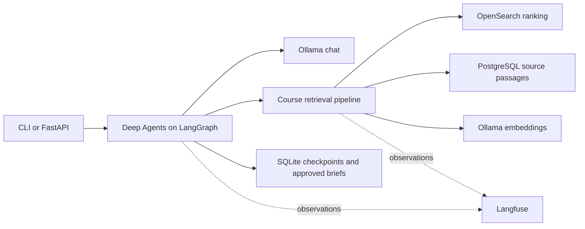

# Deep Agent Lab

Build a Python research assistant that finds internal policy, cites the passage
behind each claim, and pauses for a person to review a proposed brief. The six
modules use fictional Northstar policies on database restores, incident response,
and application access.

[Course map](docs/course.md) · [Jupyter walkthrough](notebooks/README.md) ·
[Configuration and API](docs/operations.md)

## Choose how to start

| Mode | What runs | Use it to |
| --- | --- | --- |
| Demo | Scripted model and bundled passages through the real tools, checkpoints, and approvals | Learn the mechanics with repeatable results |
| Live | Ollama chat and embeddings, the course's PostgreSQL and OpenSearch corpus, and optional Langfuse traces | Ask open-ended questions and inspect model and search behavior |

This checkout defaults to **live** through its ignored `.env`. Add `--demo` before
an agent command to use the offline fixtures. Start in PowerShell with Python
3.11–3.14 and uv:

```powershell
Set-Location 'C:\Users\imrah\Documents\deepagents'
$env:UV_CACHE_DIR = Join-Path $PWD '.uv-cache'
uv sync --locked --extra dev --extra notebook
uv run deep-lab --demo ask "Who approves a production restore?"
```

The demo identifies the **database operations lead**. Match the citation in the
answer to the `citation` field in `evidence`, then read that row's excerpt to check
the claim. [Follow the first agent turn](docs/module-1-agent-foundations.md#12-run-an-agent-and-read-its-messages)

## Run with live services

This checkout's `.env` points to `C:\Users\imrah\Documents\Rag-project\.env` for
service credentials. Start Ollama and check that `ollama list` includes the chat
model, `qwen3.5:latest` by default, and the configured embedding model, typically
`nomic-embed-text`.

```powershell
ollama list
uv run deep-lab init
uv run deep-lab doctor
uv run deep-lab ingest data/sample
uv run deep-lab documents
uv run deep-lab search "production restore approval" --mode hybrid
uv run deep-lab ask "Who approves a production restore? Cite the policy passage."
```

`documents` should include the backup, incident response, and access policies.
`search` shows ranked passages without running the chat model. `ask` lets the
model choose tools and returns an answer, retrieved evidence, tool names, and a
Langfuse trace ID when tracing is active.

The course connects directly to the configured services. It stores its corpus in
PostgreSQL schema `deep_agent_lab` and OpenSearch index `deep-agent-lab-v1`. In a new
checkout, copy `.env.example` to `.env` and set `RAG_LAB_ENV_FILE` or configure the
services directly. This checkout reuses the existing Langfuse project credentials
with content capture off. [Configuration reference](docs/operations.md#configuration)

## How the parts fit together

1. **Ingest.** Load a file, split it into passages, and ask Ollama for embeddings,
   which are vectors used to find similar text. OpenSearch indexes passages and
   vectors. PostgreSQL stores canonical documents and their active passages.
2. **Answer.** Deep Agents supplies the tools and instructions. LangGraph runs
   the steps. When Ollama requests a search, OpenSearch ranks candidates and the
   app reads the matching active passages from PostgreSQL. The model cites the
   relevant excerpts in its answer.
3. **Review.** A `save_brief` call pauses at a checkpoint. After approval, fetch the
   exact Markdown using the returned brief ID.
   [Try the review](docs/module-1-agent-foundations.md#18-pause-for-human-review)



## Run the notebook or API

```powershell
# Notebook
uv run --extra notebook jupyter lab notebooks/deep_agents.ipynb

# API
uv run uvicorn deep_agent_lab.api:app --host 127.0.0.1 --port 8001
```

The notebook starts with scripted exercises and includes an optional live cell.
The API uses the configured mode. Its interactive console exposes search, agent
runs, thread inspection, and reviews.
[Notebook guide](notebooks/README.md) · [API walkthrough](docs/operations.md#start-the-api)

## Course and source

The project pins Deep Agents `0.7.0` to match the Academy Python labs. The
ingestion and retrieval pipeline adapts code from your RAG Lab.
[Academy syllabus](https://academy.langchain.com/courses/foundation-introduction-to-deepagents) ·
[Public Python course](https://github.com/langchain-ai/lca-deepagents/tree/9e1fab37b9bcf4d672bdb6b667755f3f668a3fc8) ·
[Deep Agents SDK 0.7.0](https://github.com/langchain-ai/deepagents/tree/deepagents%3D%3D0.7.0)
