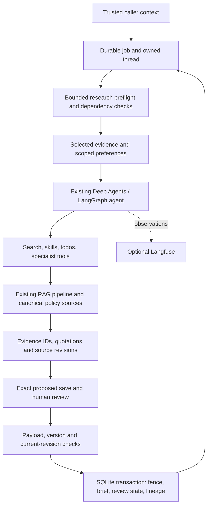

# Northstar architecture and guarantees

The course extends the original agent, retrieval service, MCP server, checkpoint
store and Langfuse wrapper. It has two entry boundaries: the existing loopback
CLI/API laboratory, and the `Northstar` Python service boundary that receives an
already authenticated `Principal`. The latter checks tenant, owner and permission
before touching a job's checkpoint or artifact. It is not an HTTP login server.

The notebook architecture figures use Matplotlib and have executed PNG outputs.
This Mermaid diagram is for Markdown renderers that support Mermaid.

`agent.py` constructs the actual Deep Agents harness. `service.py` owns graph
invocation and resumable review. The preflight in `capstone.py` performs bounded
topic searches through the same `search_knowledge` interface, verifies dependency
completion against retrieved evidence, reserves a context working set, and
preserves unresolved joint authority as a question requiring support review.
The graph can then perform additional searches or delegate. Scoped preferences
enter as user context; they cannot grant permissions or bypass review.

Evidence identity, quotation fidelity and semantic support are different checks.
`evidence.py` verifies source IDs, revisions and exact quotations. Its deterministic
verifier supports complete copied source sentences and abstains on paraphrases.
The optional model judge is a prediction requiring calibration. A human reviews
the actual proposed Markdown; an audit record of extractive claims does not prove
every generated sentence.

The production retrieval path remains PostgreSQL plus OpenSearch plus Ollama.
OpenSearch proposes candidate IDs, RRF combines rank positions, and PostgreSQL
hydrates only active canonical chunks. Hydration now retains the source revision
all the way into agent evidence and review records. Embedding profiles include
model, dimensions and prefixes; equal dimensions do not imply equal vector spaces.

The local save transaction verifies the exact approved digest, expiry and, in the
capstone, the current job token, lease, deadline and cancellation state. It commits
the brief, action status and lineage together. Identical retries reconcile an
already committed action. Review decisions are durable so recovery can replay a
decision recorded just before a process stopped. Graph checkpoints and business
writes are still separate transactions; idempotency bridges an ambiguous outcome.

The lineage record links a brief to its review action, thread, optional job and
trace, evidence revisions and evaluation contract version. Access through the
capstone first verifies the owned job. Low-level stores are trusted application
components and must not be exposed as unauthenticated endpoints.

The job queue supports durable input, attempts, backoff, deadlines, lease renewal,
reclaim, cancellation and fenced completion. It is a local SQLite reference,
not a distributed graph server. A lease does not stop an old process, and fencing
protects only boundaries that check the token. Long remote calls need appropriate
lease renewal and transport cancellation. A strict live policy-revision check and
commit across PostgreSQL and SQLite need additional transaction coordination or
an explicit immutable-snapshot policy; this course does not claim cross-database
atomicity.

Trace content is off by default. SDK/exporter failures are isolated from research,
and exception messages are replaced with exception types in observations. Local
checkpoints still contain prompts and evidence. Arbitrary metadata is not
automatically safe merely because prompt capture is disabled.
